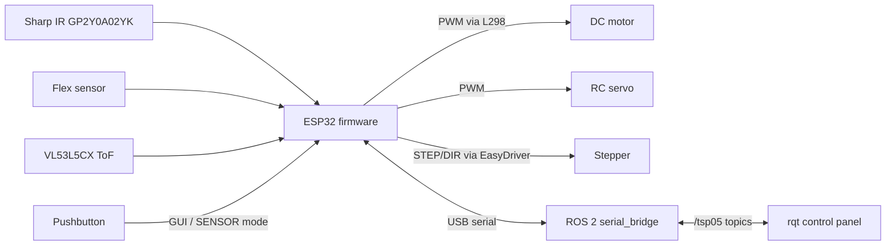
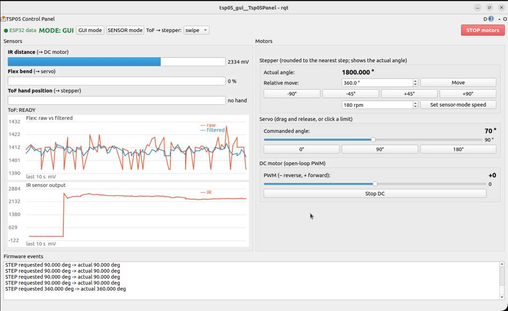
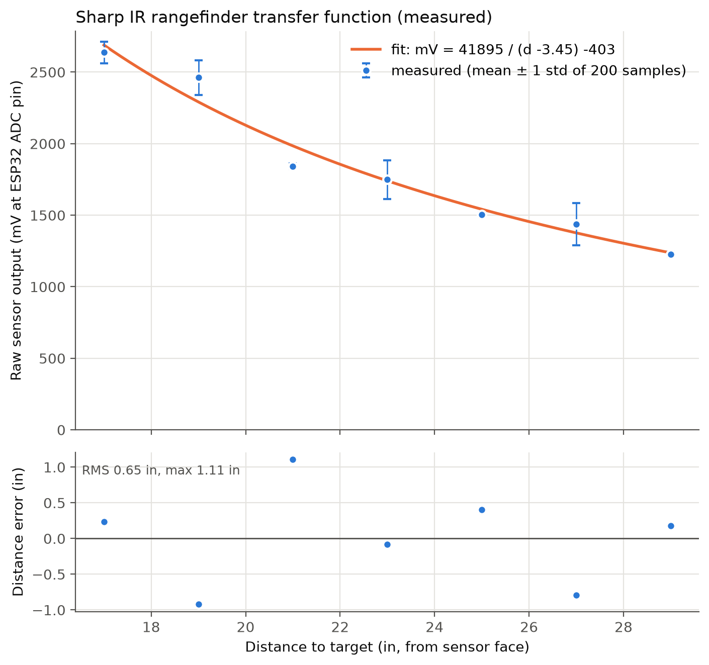

# TSP05: Sensors & Motor Control Lab

*Bench demo at 3× speed ([MP4](media/demo_3x.mp4)): one ESP32 runs all sensors and motors. Sensors drive the motors: IR distance → DC motor speed, flex bend → servo angle, VL53L5CX ToF hand swipe → stepper.*

Goal: To use 3 sensors and 3 motors with ESP32

**Run it:** [docs/HOW_TO_RUN.md](docs/HOW_TO_RUN.md): install, flash and test the integrated firmware on Ubuntu or macOS.

## System overview

- [firmware/tsp05_main](firmware/tsp05_main/README.md): integrated firmware, serial commands and the Wokwi simulator. Pin map: [docs/PINOUT.md](docs/PINOUT.md).
- [ros2_ws/src/tsp05_bridge](ros2_ws/src/tsp05_bridge/README.md): ROS 2 node that talks to the ESP32 over serial and publishes `/tsp05/...` topics.
- [ros2_ws/src/tsp05_gui](ros2_ws/src/tsp05_gui/README.md): rqt control panel. Start everything with `ros2 launch tsp05_gui system.launch.py port:=/dev/ttyUSB0`.

## Individual contributions

### Aaron Chou — firmware integration and ROS 2 bridge
- Merged all sensors and motors into one ESP32 program ([firmware/tsp05_main](firmware/tsp05_main/README.md)), one module per sensor–motor pair, plus a shared pin map ([config.h](firmware/tsp05_main/src/config.h)).
- GUI/SENSOR mode switch from a pushbutton (internal pull-up, 30 ms software debounce) or the `mode` serial command. Switching modes stops the motors.
- Stepper motion profile ([stepper_ctrl.cpp](firmware/tsp05_main/src/stepper_ctrl.cpp)): moves start at 60 rpm and ramp to 180 rpm (max 300). Step rate = rpm × 1600 steps/rev / 60 at 1/8 microstepping.
- Added a "follow-the-hand" ToF mode for the stepper, alongside swipe mode.
- Firmware telemetry as `name:value` lines every 100 ms.
- ROS 2 serial bridge ([tsp05_bridge](ros2_ws/src/tsp05_bridge/README.md)): parses the telemetry into topics and forwards commands. Includes a fake ESP32 for testing without hardware and protocol unit tests.
- Wokwi simulation setup, run guide ([HOW_TO_RUN.md](docs/HOW_TO_RUN.md)) and demo video.

### Mayank Chandak — ToF gesture sensing and GUI
- VL53L5CX bring-up ([bringup/tof_vl53l5cx](bringup/tof_vl53l5cx/README.md)) and swipe detection ([bringup/tof_swipe](bringup/tof_swipe/src/main.cpp)):
  - 4×4 zones at 30 Hz.
  - Each zone's background distance is recorded over about 1 s at start-up.
  - A zone counts as "hand" if it is 30–400 mm away and at least 100 mm closer than its background.
  - Hand position is the distance-weighted average column. A swipe is ≥ 1.5 columns of travel within 60–1500 ms, and each swipe turns the stepper ±45°.
- rqt control panel ([panel_widget.py](ros2_ws/src/tsp05_gui/tsp05_gui/panel_widget.py)):
  - Mode buttons, stop button, and stepper, servo and DC motor controls.
  - Live plots of flex raw vs filtered and of IR output.
  - Talks only through `/tsp05/...` topics.
- Running ROS 2 in a UTM VM on a Mac without USB passthrough: the serial port is forwarded over the network (`socket://`). Fixed the bridge to read the full buffer so this works.
- Recorded the first IR transfer-function measurement run.

### Mayanka Medhe — IR → DC motor and IR transfer function
- IR → DC motor sketch ([IR_distance.ino](IR_distance.ino)): Sharp IR on A0, L298 (ENA pin 9, IN1/IN2 pins 7/8). The reading is clamped to calibrated thresholds of 100 counts (far) and 600 counts (near) and mapped to PWM 0–255. Also documented the Uno → ESP32 pin mapping ([readme_IR_distance.md](readme_IR_distance.md)).
- Transfer-function tool ([tools/ir_transfer_function](tools/ir_transfer_function/README.md)):
  - ESP32 logger reads GPIO14 at 200 Hz and outputs raw counts and calibrated mV.
  - Python capture averages 200 samples per distance (cm or inches).
  - Plot step fits `V = k/(d + d0) + c` and reports the distance error of the inverse conversion.
- Result over 17–29 in: fit `V = 41895/(d − 3.45) − 403` (mV, inches), conversion error **RMS 0.65 in, max 1.11 in**. Data: [ir_run1_clean.csv](tools/ir_transfer_function/data/ir_run1_clean.csv).

### Rai Pujol — stepper, IR detection logic and GUI units
- ESP32 + EasyDriver stepper controller ([stepper_driver_Systems.ino](bringup/stepper_driver_Systems/stepper_driver_Systems.ino)): serial commands for degree moves, rpm and continuous mode at 1600 pulses/rev. It is the base of the integrated stepper module.
- IR → DC motor behaviour ([ir_dc.cpp](firmware/tsp05_main/src/ir_dc.cpp)):
  - Motor is off until a hand is detected (on at 900 mV, about 80 cm; off below 750 mV, a hysteresis band).
  - When detected, the motor starts at PWM 90 (just above the friction deadband) and rises to 255 at 2500 mV (about 20 cm).
  - EMA filter (α = 0.4) on the IR voltage.
- Documented the ESP32 pinout ([PINOUT.md](docs/PINOUT.md)).
- GUI update (branch `rai/gui-requirements`):
  - Sensor values in physical units: IR in cm, flex in degrees, ToF bearing.
  - IR raw vs filtered plot.
  - DC position and velocity controls.
  - Unit tests for the conversions.

### Shi Chen (BillyChern) — flex sensor → servo
- Flex sensor with a 10 kΩ divider on A0 drives an HS-311 servo powered from an external 5 V supply ([flex_servo.ino](contributions/BillyChern/flex_servo/flex_servo.ino)).
- Calibrated endpoints of 477 (straight) and 521 (bent) ADC counts. The reading goes through an EMA filter (α = 0.15) and is mapped to a 70–150° servo command.
- Wiring diagram and test procedure: [flex_servo README](contributions/BillyChern/flex_servo/README.md). The same calibration is used in [flex_servo.cpp](firmware/tsp05_main/src/flex_servo.cpp).

## Challenges

- **IR fold-back at close range.** Below about 20 cm the Sharp output drops again, so one voltage can mean two distances. Fix: keep the hand ≥ 20 cm away, and fit the transfer function only from the voltage peak outward.
- **Bad IR measurement points.** Some readings were stuck at 0 V; a powered Sharp never outputs below about 0.3 V, which points to a loose wire. Points alternated between low noise (std ~15 mV) and high noise (std ~130 mV), suggesting the target or wires moved during sampling. Fix: dropped the bad points, check the live stream before recording, and add a 10 µF capacitor across the sensor supply.
- **DC motor deadband and chatter.** Low PWM values don't overcome friction, and the motor flickered at the edge of the IR range. Fix: jump straight to PWM 90 on detection, and use separate on/off thresholds (900 / 750 mV).
- **DC driver on ESP32 strapping pins (0, 2, 15).** These pins float during reset and flashing, so the motor can spin and uploads can fail. Fix: motor power off while flashing; moving to GPIO 18/19/23 is the permanent fix.
- **Porting from Uno to ESP32.** The ESP32 ADC is 3.3 V max and nonlinear. Fix: use factory-calibrated millivolts, convert Uno thresholds from counts to mV, and power the flex divider from 3V3.
- **Flex sensor reading stuck at 1023.** It was a bad breadboard connection, found by measuring the divider resistance to ground. The endpoints also shift with how the strip is held, so a bending fixture is needed for accurate angles.
- **Stepper stalling at high speed.** Starting at full speed skipped steps. Fix: an acceleration ramp from 60 rpm.
- **ToF false detections.** The desk and wires showed up as a hand. Fix: per-zone background calibration at start-up, plus a 100 mm margin. ToF reading runs as a separate task on core 0 so it doesn't delay stepper pulses.
- **No USB passthrough to the Ubuntu VM on Mac.** Fix: forward the serial port over the network (`socket://`), which needed a bridge fix to read the full buffer.
