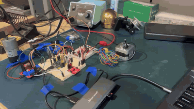

# TSP05: Sensors & Motor Control Lab

*Bench demo at 3× speed ([MP4](media/demo_3x.mp4)): one ESP32 runs all sensors and motors. Sensors drive the motors: IR distance → DC motor speed, flex bend → servo angle, VL53L5CX ToF hand swipe → stepper.*

Goal: To use 3 sensors and 3 motors with ESP32

**Run it:** [docs/HOW_TO_RUN.md](docs/HOW_TO_RUN.md): install, flash and test the integrated firmware on Ubuntu or macOS.

## Flex sensor and servo — BillyChern

[Wiring, calibration, and standalone Uno R3 test](contributions/BillyChern/flex_servo/README.md)

This contribution is a bench test for the flex sensor and RC servo. It is not yet the unified team system or a completed measurement of sensor error.

## Integrated firmware (all sensors and motors on one ESP32)

[firmware/tsp05_main](firmware/tsp05_main/README.md): build, flash, serial commands, and how to run it in the Wokwi online simulator. Pin map: [docs/PINOUT.md](docs/PINOUT.md).

## ROS 2 bridge and GUI

- [ros2_ws/src/tsp05_gui](ros2_ws/src/tsp05_gui/README.md): the **control panel** (rqt). Shows every sensor and motor, switches GUI/SENSOR mode, and commands the motors. Start everything with `ros2 launch tsp05_gui system.launch.py port:=/dev/ttyUSB0`.
- [ros2_ws/src/tsp05_bridge](ros2_ws/src/tsp05_bridge/README.md): the ROS 2 node that talks to the ESP32 over serial, publishes sensor and motor state on `/tsp05/...` topics, and forwards GUI commands. Includes a fake ESP32 for testing without hardware.
