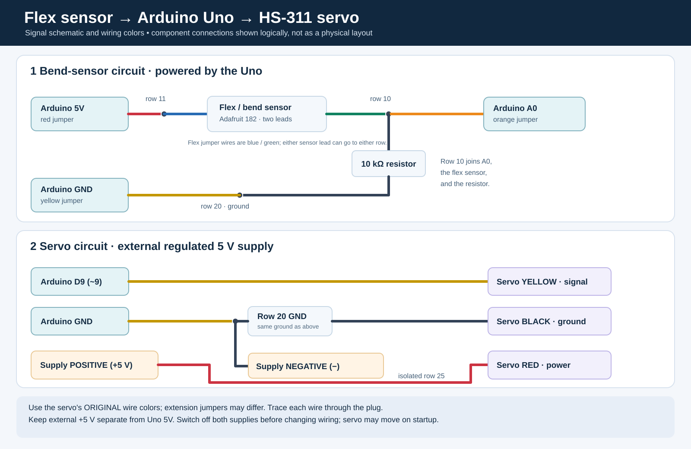

# Flex sensor → RC servo (BillyChern)

Standalone bench test using an Arduino Uno R3, an Adafruit 182 long flex sensor, and a Hitec HS-311 positional servo. Bending the sensor changes the servo command. This is a bring-up sketch for integration into the team's single program; it is **not** the complete lab submission.

## Sensor identification

The sensor package says “Long Flex/Bend sensor,” and [Adafruit product 182](https://www.adafruit.com/product/182) describes a bend sensor. It does **not** directly measure contact force. The course guidelines label the link to that product as a force-sensitive resistor, while the team signup lists a force sensor; confirm the intended sensor with the TA. Do not report its readings as newtons or claim this test verifies grasp force.

## Parts

- Arduino Uno R3, USB cable and solderless breadboard
- Adafruit 182 flex sensor; fixed **10 kΩ** resistor (measured approximately 9.8 kΩ); jumper wires
- Hitec HS-311 RC servo, externally powered from a regulated **5.0 V DC** supply with enough current (approximately 1 A capacity is a reasonable starting point)
- Arduino Servo library; a laptop with Arduino IDE

## Color-coded wiring



These are the colors observed on the team's **Uno jumpers and original servo lead**. The servo's extension wires use different colors: trace each extension back to its original red, black, or yellow servo wire before connecting. The two flex-sensor leads are interchangeable; blue and green were used on our bench, but their order was not recorded.

| Connection | Team color | Destination |
| --- | --- | --- |
| Uno **5V** | Red Uno jumper | Breadboard row **11**, A–E side; same row as one flex-sensor lead |
| Uno **A0** | Orange | Row **10**, A–E side; same row as the other flex lead and one 10 kΩ resistor leg |
| Uno **GND** | Yellow Uno jumper | Row **20**, A–E side; same row as the other resistor leg, servo ground and supply negative |
| Flex sensor | Blue and green jumpers | One lead to row **11** and the other to row **10**; the sensor is not polarized |
| 10 kΩ fixed resistor | Brown–black–orange–gold for a common 4-band part | Between rows **10** and **20**; orientation does not matter |
| Servo **signal**, original lead | Yellow | Uno digital **~9 / D9** |
| Servo **power**, original lead | Red | External regulated **+5 V**; an isolated row **25** can join these two wires |
| Servo **ground**, original lead | Black | Supply negative and Uno GND, e.g. row **20** |
| External supply **negative** | Check the supply's markings | Same ground as the servo black and Uno GND, e.g. row **20** |

On a typical breadboard, holes **A–E in one numbered row** are connected. The F–J side is separated by the center gap. Confirm your board before wiring. Rows 10, 11, 20, and 25 are examples of separate nodes; actual holes may differ as long as the electrical connections match.

```text
Uno 5V (red jumper) ── flex sensor ──┬── Uno A0 (orange jumper)
                                     │
                                  10 kΩ
                                     │
Uno GND (yellow jumper) ─────────────┴── supply negative ── servo BLACK
Uno D9 ─────────────────────────────────────────────────── servo YELLOW
External regulated +5 V ───────────────────────────────── servo RED
```

**Power:** Switch off the bench output and unplug USB before changing wires. The Uno gets power via USB; the servo gets power from the external supply. Join their **grounds**, but do **not** connect the bench supply's positive output to the Uno 5V pin or its USB supply. Verify the bench supply voltage and polarity before connecting. The course guidelines recommend an external servo supply. Servo movement at startup is possible; secure the body, keep the horn clear and stop if it binds or buzzes.

## Run the test

1. Open `flex_servo.ino` in Arduino IDE. Select **Arduino Uno**, the connected port, and install the official **Servo** library if needed.
2. With the connections checked, connect Uno USB and turn on the external 5 V servo supply.
3. Upload the sketch and open **Serial Monitor at 115200 baud**. Gently bend and straighten the sensor; the servo should move. Bend the active strip gradually and support the delicate connector end.
4. If your sensor or wiring differs, note the straight and comfortable-bend raw readings and update `STRAIGHT_ADC` and `BENT_ADC` in the sketch. The normalization supports either direction of change. Do not force the servo horn against a stop; 150° is close to the HS-311's nominal pulse endpoint.

## Observations and limits

- On our bench, the sensor read approximately **477 straight** and **521 at a comfortable bend**. These are device- and setup-specific ADC counts, not universal values.
- The program filters the ADC reading, normalizes it between the two observed endpoints, and sends a **70–150° servo command**. The Serial Monitor prints `raw`, `filtered`, `bend_pct`, and `servo_cmd_deg`.
- `bend_pct` is a clipped percentage of the demonstrated range, not a measured physical angle. `servo_cmd_deg` is the **command**, not independent measurement of the shaft's actual position.
- The user confirmed servo movement with the external supply. Further measurements are needed to convert sensor data to physical bend angle, establish error over the usable range, and produce the required measured transfer plot and raw/filtered comparison.
- The team's complete system still needs the other sensors, motors, GUI/ROS 2 interface, and one unified Uno program. During integration, replace the standalone `delay(20)` with nonblocking timing if required. On Uno R3, using the Servo library disables `analogWrite()` PWM on pins 9 and 10; coordinate the DC motor's PWM pin.

## Individual contribution and challenges

**BillyChern (Shi Chen):** wired and tested the bend-sensor divider and HS-311 servo with the Uno R3; helped debug the A0 signal and breadboard connections; recorded the straight/bent ADC endpoints; tested the sensor-driven servo and external supply; and documented the wiring and test procedure. The sketch implements filtered sensor input, bounded servo commands, and serial reporting.

The initial A0 reading sat at or near 1023. Checking A0 directly against ground and measuring approximately 9.8 kΩ between the intended signal and ground rows helped isolate the breadboard connection. After reconnecting the divider, the straight reading was approximately 477 and changed when bent. Endpoint readings vary with how the strip is held, so a repeatable bending fixture and multiple reference-angle measurements are still needed for accuracy claims.
