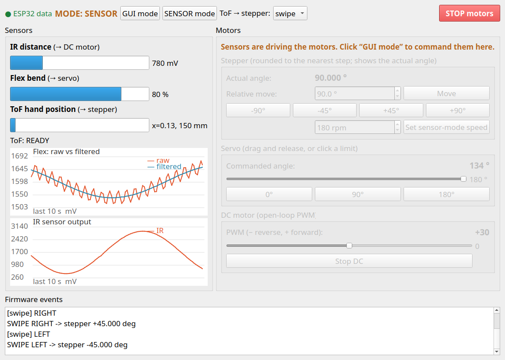

# tsp05_gui: TSP05 control panel (rqt)

The lab GUI: a custom **rqt** panel (the guideline allows rqt). It shows the state of every sensor and motor and sends motor commands, all through the ROS 2 topics of [`tsp05_bridge`](../tsp05_bridge/README.md).



*Screenshot taken with `fake_esp32` (simulated data), in SENSOR mode.*

| Area | What it does |
|---|---|
| Top bar | Data indicator (green = ESP32 data arriving), current **mode**, **GUI mode** / **SENSOR mode** buttons, ToF → stepper style (swipe/follow), **STOP motors** |
| Sensors | IR voltage, flex bend %, ToF hand position and distance, ToF state; live plots of **flex raw vs. filtered** (filter demo) and IR output |
| Stepper | **Actual angle** (after rounding to whole steps), relative move by any number of degrees, ±45°/±90° buttons, sensor-mode speed |
| Servo | Slider 0–180° (sends on release), buttons for both limits and the middle |
| DC motor | PWM slider −255…255 (sign = direction), Stop |
| Firmware events | Mode changes, swipes, command replies |

Motor controls are greyed out in SENSOR mode, because the firmware ignores typed motion commands while the sensors drive the motors.

## Run (Ubuntu with ROS 2 Humble or Jazzy)

First time on this machine? Full install steps (ROS 2, build tools, serial permissions): [docs/HOW_TO_RUN.md, Part B](../../../docs/HOW_TO_RUN.md#part-b-ros-2-and-the-gui-ubuntu).

ROS 2 doesn't run natively on macOS, so **plug the ESP32 into the Ubuntu machine** (for example the lab desktop) for this part. Close any serial monitor first.

```bash
cd ros2_ws
source /opt/ros/<distro>/setup.bash      # humble or jazzy
colcon build --symlink-install
source install/setup.bash
ros2 launch tsp05_gui system.launch.py port:=/dev/ttyUSB0
```

This starts the serial bridge and opens the panel. Wait for `ToF: READY`.

- **No hardware:** `ros2 run tsp05_bridge fake_esp32` in another terminal, then use the `/dev/pts/N` it prints as `port:=`.
- **`Permission denied` on the port:** `sudo usermod -aG dialout $USER`, then log out and back in. For one session only: `sudo chmod a+rw /dev/ttyUSB0`.
- **Panel only** (bridge already running): `ros2 run tsp05_gui tsp05_gui`. Inside a running `rqt`, it's under *Plugins → TSP05 → TSP05 Control Panel* (run `rqt --force-discover` once after building).
- **Panel says "no data":** the bridge isn't running, the port is wrong, or another program holds the port.
